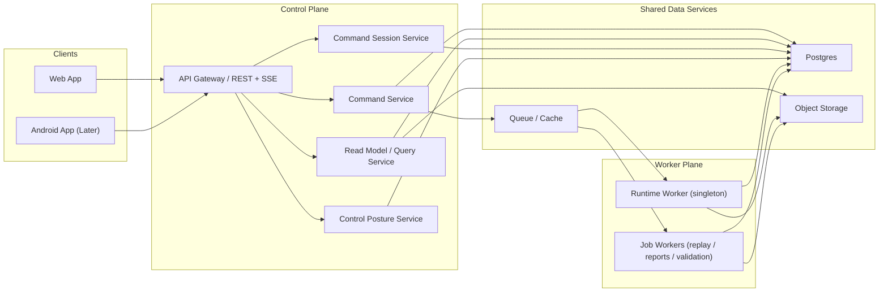

# TradingX Headless Control Plane Architecture

## 1. Executive Summary

TradingX will evolve from a local supervised trading appliance into a
headless, cloud-deployable system with a stable control plane. The
frontend becomes a client of that control plane instead of a peer of
local services and file-backed artifacts.

The target architecture is a two-plane system:

- a **Control Plane** that owns APIs, command intake, safety posture,
  read models, sessions, audit, and operator-facing truth
- a **Worker Plane** that owns the long-lived trading runtime plus
  asynchronous jobs such as replay, validation packaging, and report
  generation

This document defines the production-grade target for:

- service boundaries
- deployment topology
- command/session security
- canonical API contracts
- storage and projection model
- local development stack
- migration boundaries from the current local appliance

It is intentionally opinionated. The goal is not a quick remote wrapper
around the current local web app. The goal is a real headless control
plane that can support web first and Android later without redesigning
the backend boundary again.

This architecture inherits UI/control requirements from:

- [TradingX Frontend UX & Information Architecture](/Users/ahmedabd/Desktop/AI%20Projects/TradingX/docs/architecture/TradingX_Frontend_Design.md:1)
- [TradingX Dashboard & Design System](/Users/ahmedabd/Desktop/AI%20Projects/TradingX/docs/architecture/TradingX_Dashboard_And_Design_System.md:1)

## 2. Status and Decision Shape

This is a **target architecture design**, not a statement that the
current codebase already matches it.

Decision posture:

- **Chosen direction:** Control Plane + Worker Plane
- **Client strategy:** web first, Android later, both on the same API
- **Runtime strategy:** cloud-deployable, locally runnable, fail-closed
- **Migration strategy:** staged migration, not a big-bang rewrite

## 3. Goals

1. Run the bot headless in the cloud without requiring the UI to be
   open.
2. Support a local web app now and a mobile client later using the same
   API contracts.
3. Remove direct UI dependence on local files, SQLite assumptions,
   Python module seams, and process-management internals.
4. Preserve governed writes, fail-closed live posture, and explicit
   operator intent.
5. Provide first-class APIs for runtime state, incidents, analytics,
   validation, replay, and documents so the UI does not parse artifacts.
6. Keep the system runnable locally with the same contracts used in the
   cloud.
7. Make long-running actions asynchronous, auditable, idempotent, and
   resumable across reconnects and devices.

## 4. Non-Goals

1. This design does not add discretionary trade entry or manual trading
   terminal behavior.
2. This design does not make the frontend responsible for secret
   management.
3. This design does not require full microservice decomposition by
   domain.
4. This design does not define a final vendor choice for hosting,
   identity, or observability tooling.
5. This design does not replace existing quantitative or validation
   logic; it re-houses them behind cleaner boundaries.

## 5. Architecture Principles

### 5.1 Control Plane Owns Operator Truth

The UI never infers control posture, command state, runtime health, or
validation readiness by stitching together local files or private
service assumptions. The control plane exposes authoritative operator
truth.

### 5.2 Worker Plane Owns Execution

The bot runtime and long-running jobs do not execute inside the web/API
request path. The control plane accepts work; the worker plane executes
it.

### 5.3 Postgres Is the System of Record

Postgres stores canonical operational state, audit history, metadata,
and projection state. Object storage holds large immutable artifacts.
Redis or equivalent queue/cache infrastructure is useful, but it is not
the source of truth.

### 5.4 Commands Are Governed Transactions

Commands are not direct function calls. They are explicit intents with:

- authenticated user context
- short-lived command-session context
- timestamp freshness
- idempotency keys
- policy gating
- durable lifecycle tracking

### 5.5 Reads Are Domain APIs First, Workspace Snapshots Second

Page-shaped snapshots are allowed as convenience read models, but every
workspace must still sit on canonical domain APIs.

### 5.6 Local and Cloud Must Share Contracts

Local testing is not a second architecture. It runs the same service
contracts on smaller infrastructure.

## 6. Target Topology



## 7. Deployment Model

### 7.1 Production Shape

Production-grade deployment consists of:

1. **Static Web Client**
   - CDN-hosted SPA
   - environment-specific API base URL
   - no embedded long-lived control secrets

2. **Control Plane Service**
   - stateless containerized API service
   - horizontally scalable
   - owns authenticated reads, command intake, projections, and SSE

3. **Runtime Worker**
   - long-lived singleton worker per environment
   - owns scheduler-bound trading runtime, runtime heartbeats, broker
     sync, and live/paper execution path

4. **Job Worker Pool**
   - replay jobs
   - validation/report generation
   - analytics refresh
   - evidence packaging

5. **Managed Postgres**
   - primary system of record
   - PITR/backups required

6. **Object Storage**
   - S3-compatible
   - immutable reports/artifacts and larger payloads

7. **Queue/Cache Layer**
   - Redis Streams, Redis-backed queue, or equivalent
   - used for command dispatch, job orchestration, and short-lived cache

8. **Observability Stack**
   - logs, metrics, traces, alerting, dashboards

### 7.2 Environment Set

- **Local:** full stack on one machine, paper-only default
- **Dev:** shared cloud environment, low-cost, paper-only
- **Staging:** production-like topology, paper-only or dry-run only
- **Prod:** fail-closed, live-capable only when control posture allows

### 7.3 Platform Neutrality

This architecture works on managed containers plus managed data
services. Suitable targets include ECS/Fargate, Kubernetes, Render,
Fly.io, or similar platforms. Vendor selection is a later delivery
decision, not an architecture blocker.

## 8. Service Boundaries

### 8.1 Web App

Responsibilities:

- render Mission Control, Portfolio, Validation, Command Center,
  Investigations, and Governance workspaces
- open authenticated sessions
- establish short-lived command sessions
- subscribe to SSE topics
- render operator state and analytics

Must not:

- parse local artifacts
- decide trading/risk logic
- own long-lived signing credentials
- infer fail-closed state from unrelated payloads

### 8.2 Control Plane Service

Responsibilities:

- user authentication integration
- command session creation and lifecycle
- command acceptance, validation, policy gating, idempotency, and audit
- canonical reads for all frontend workspaces
- SSE event fanout
- projection updates from outbox/domain events
- document/report indexing

Must not:

- run long-lived trading loops in-process
- hide async actions behind fake synchronous success
- expose secrets through safe read APIs

### 8.3 Runtime Worker

Responsibilities:

- market-day runtime lifecycle
- scheduled evaluations and next-action determination
- broker connectivity and order path
- runtime heartbeats
- writing decision and execution events
- enforcing live/paper controls at execution time

Singleton rule:

- exactly one active runtime worker per environment and trading domain
- distributed lease required in cloud

### 8.4 Job Workers

Responsibilities:

- replay generation
- validation packaging
- PBO/CPCV materialization jobs
- performance aggregation refresh jobs
- evidence and report generation

These are independent from the runtime worker and may scale out.

### 8.5 Shared Data Services

- **Postgres** for canonical state and metadata
- **Object Storage** for immutable large artifacts
- **Queue/Cache** for dispatch and ephemeral acceleration

## 9. Domain Ownership

| Domain | Primary owner | Notes |
| --- | --- | --- |
| Command intake and audit | Control Plane | source of truth for command lifecycle |
| Runtime state and heartbeat | Runtime Worker + Control Plane projections | worker emits, control plane serves |
| Control posture | Control Plane | combines config, policy, runtime, and safety gates |
| Incident tracking | Control Plane projections | worker and jobs emit source events |
| Portfolio analytics | Job Workers + Control Plane reads | analytics materialized into Postgres |
| Validation and evidence | Job Workers + Control Plane reads | artifacts in object storage, metadata in Postgres |
| Replay and investigations | Job Workers + Control Plane reads | replay runs are async workloads |
| Documents and reports | Control Plane indexing | blob content in object storage |

## 10. Command, Session, and Security Model

### 10.1 Authentication Baseline

The user authenticates with a normal application identity layer
(OIDC/session cookie/token). That identity proves *who* the operator is.

It does not by itself authorize sensitive writes.

### 10.2 Command Sessions

Sensitive writes require a short-lived **command session** that proves
recent operator intent.

Command session lifecycle:

1. User is already authenticated.
2. Client requests a command session with a step-up factor:
   - web: password/WebAuthn/TOTP depending on deployment choice
   - mobile: biometric unlock backed by device keystore plus server
     challenge
3. Control plane creates:
   - `command_session_id`
   - `command_session_token`
   - `session_signing_context` or equivalent short-lived proof material
   - `expires_at`
   - `allowed_scopes`
4. Client keeps the proof material only in volatile memory or secure
   device storage for the short session lifetime.
5. Session may be refreshed until server-side policy cap is reached.
6. Session expires automatically or may be revoked explicitly.

### 10.3 How Signed Writes Work

The target cloud model preserves the signed-write invariant from
`ADR-0025` without long-lived client-owned secrets.

The canonical wire contract for governed writes remains header-based for
continuity with `ADR-0025`.

Every governed write uses:

- `Authorization: Bearer <user access token>`
- `X-TradingX-Command-Session: <opaque command session token>`
- `X-TradingX-Timestamp`
- `X-TradingX-Idempotency-Key`
- `X-TradingX-Signature`

`X-TradingX-Signature` is generated from:

- HTTP method
- request path
- body hash
- timestamp
- idempotency key
- command session proof material minted by `/api/v1/command-sessions`

This means the cloud/mobile evolution changes the source of signing
material, not the canonical header names seen by the verifier. The
existing local Gate 4 browser-unlock flow remains a compatible local
deployment profile under the same signed-write contract.

Verification rule:

- the control plane validates the normal user auth
- validates the command session
- validates freshness
- validates proof signature
- validates policy before accepting the command

This keeps writes explicitly signed while ensuring the client never owns
the long-lived platform secret.

### 10.4 Mutation Preconditions and Concurrency

Idempotency alone is not sufficient in a multi-operator cloud
deployment. Commands that mutate shared operational state must also
declare the state they expect to transition from.

Required precondition model for governed mutations:

- `target_resource_id`
- `target_resource_type`
- `expected_resource_version`
- `expected_state` or equivalent state fingerprint
- `requested_transition`

Rules:

- preconditions are mandatory for safety-critical commands that mutate a
  versioned shared resource
- omitted preconditions are allowed only for append-only or targetless
  commands such as report generation
- if the target has changed since the operator last read it, the command
  is rejected as `blocked` with reason code `precondition_failed`
- the system must not degrade to last-writer-wins for governed
  operational state

Examples:

- acknowledging an incident must name the incident version expected by
  the operator
- changing a kill-switch posture must name the expected current posture
- pause/resume/stop transitions must name the expected runtime state

### 10.5 Idempotency and Replay

Idempotency rules:

- same idempotency key + same effective fingerprint:
  - replay original accepted result
- same idempotency key + different fingerprint:
  - reject as `conflicting`
- stale timestamp:
  - reject as `stale`

The first accepted response is stored durably and is replayable to the
client for the duration of the retention window.

### 10.6 Command Lifecycle

Canonical lifecycle:

- `accepted`
- `queued`
- `in_progress`
- `completed`
- `failed`
- `canceled`
- `blocked`
- `replayed`
- `stale`
- `conflicting`

UI presentation may compress some of these, but the backend must not.

## 11. Canonical API Design

### 11.1 API Conventions

- Versioned under `/api/v1`
- JSON for request/response bodies
- SSE for realtime fanout
- every response includes `request_id` and `generated_at`
- every list endpoint supports stable cursor pagination
- every major resource has immutable ids

Suggested response envelope:

```json
{
  "request_id": "req_...",
  "generated_at": "2026-04-23T15:00:00Z",
  "data": {}
}
```

### 11.2 Control Posture API

#### `GET /api/v1/control-posture`

Purpose:

- power the ubiquitous Live Enablement Panel
- explain why live is blocked or allowed

Required fields:

```json
{
  "requested_mode": "paper | live",
  "effective_mode": "paper | live",
  "live_allowed": false,
  "explicit_blockers": [
    {
      "code": "write_signing_not_configured",
      "severity": "hard_block",
      "message": "Signed web writes are not configured."
    }
  ],
  "live_control_layer_states": {
    "broker_credentials_present": true,
    "config_live_enabled": false,
    "env_live_opt_in_enabled": false,
    "write_signing_configured": false,
    "manual_kill_switch_active": false,
    "dry_run_active": true
  },
  "governance_posture": {
    "operator_signoff_required": true,
    "operator_signoff_status": "missing",
    "gate4_checklist_status": "missing",
    "approved_by": null,
    "approved_at": null
  },
  "market_data_posture": {
    "mode": "paper",
    "aligned_with_effective_mode": true,
    "status": "nominal"
  },
  "fail_closed_reasons": [
    "config_live_disabled",
    "env_live_opt_in_disabled",
    "dry_run_active",
    "operator_signoff_missing"
  ]
}
```

### 11.3 Command Session API

#### `POST /api/v1/command-sessions`

Creates a short-lived privileged write session after step-up auth.

Response fields:

- `command_session_id`
- `command_session_token`:
  canonical value carried in `X-TradingX-Command-Session`
- `proof_scheme`
- `session_signing_context` or equivalent challenge material
- `expires_at`
- `allowed_scopes`

`command_session_id` is retained for audit, status lookup, and
introspection. It is not used as the write-authorization bearer value on
the wire.

#### `POST /api/v1/command-sessions/{session_id}/refresh`

Returns fresh expiry/proof material if policy allows refresh.

#### `POST /api/v1/command-sessions/{session_id}/revoke`

Server-side revocation.

#### `GET /api/v1/command-sessions/{session_id}`

Returns:

- `status`
- `expires_at`
- `allowed_scopes`
- `last_used_at`

No endpoint may reveal long-lived server secrets.

### 11.4 Commands API

#### `POST /api/v1/commands`

Accepts governed actions.

Request body fields:

- `command_type`
- `target`
- `parameters`
- `preconditions`
  - `target_resource_id`
  - `target_resource_type`
  - `expected_resource_version`
  - `expected_state`
  - `requested_transition`

Required request headers:

- `X-TradingX-Command-Session`
- `X-TradingX-Timestamp`
- `X-TradingX-Idempotency-Key`
- `X-TradingX-Signature`

Response fields:

```json
{
  "command_id": "cmd_123",
  "job_id": "job_123",
  "disposition": "accepted | replayed | blocked | stale | conflicting",
  "lifecycle_state": "accepted | queued | in_progress | completed | failed | canceled | blocked | replayed | stale | conflicting",
  "block_reason_code": "precondition_failed | policy_block | null",
  "accepted_at": "2026-04-23T15:00:00Z",
  "status_url": "/api/v1/commands/cmd_123",
  "events_url": "/api/v1/commands/cmd_123/events"
}
```

#### `GET /api/v1/commands/{command_id}`

Returns command summary, status, timestamps, actor, target, and current
error/failure detail if any.

#### `GET /api/v1/commands`

Supports recent history, filters, pagination, and audit views.

Recommended filters:

- `status`
- `command_type`
- `actor_id`
- `since`
- `until`
- `target`

#### `GET /api/v1/commands/{command_id}/events`

Returns ordered command timeline events for the Command Center.

### 11.5 Runtime API

#### `GET /api/v1/runtime`

Returns current runtime posture:

- lifecycle state
- current activity
- current evaluation state
- next planned action
- next evaluation time
- current universe
- active strategy/model snapshot
- heartbeat freshness

#### `GET /api/v1/runtime/heartbeats`

Recent heartbeat history for Mission Control and audit use.

Runtime changes and countdown-driving freshness events are consumed from
`GET /api/v1/stream?topics=runtime`.

### 11.6 Incidents and Events APIs

#### `GET /api/v1/incidents`

Returns structured incidents with severity, state, acknowledgement, and
linked resources.

Incident acknowledgement is a governed command on
`POST /api/v1/commands` with `command_type = "acknowledge_incident"`.
There is no second canonical mutation path for incident state.

#### `GET /api/v1/events`

Canonical timeline/event stream across runtime, validation, commands,
and market-data posture.

### 11.7 Portfolio and Analytics APIs

#### `GET /api/v1/portfolio`

Portfolio summary:

- NAV/equity
- realized/unrealized P&L
- gross/net exposure
- concentration
- turnover
- risk budget usage

#### `GET /api/v1/portfolio/positions`

Position list with filters and symbol grouping.

#### `GET /api/v1/portfolio/performance`

Time-series analytics with filters:

- symbol
- group/sleeve
- time range
- benchmark
- portfolio slice

Must support:

- benchmark comparison
- symbol/group performance over time
- P&L over time
- drawdown series
- attribution
- risk/concentration rollups

#### `GET /api/v1/portfolio/execution-quality`

Execution metrics, slippage, rejects, and latency summaries.

### 11.8 Validation and Evidence APIs

#### `GET /api/v1/validation/readiness`

Returns current gate/candidate readiness summary.

#### `GET /api/v1/validation/candidates/{candidate_id}/criteria`

Criterion-level results with:

- `pass | fail | pending`
- effective status derivation for legacy `null`
- readiness blockers
- evidence references

#### `GET /api/v1/validation/reports`

Historical validation reports and decision briefs.

#### `GET /api/v1/validation/pbo-reports`

Historical PBO runs and audit trail.

### 11.9 Investigations and Replay APIs

#### `GET /api/v1/investigations`

Investigation sessions and saved workspaces.

Replay creation is a governed command on `POST /api/v1/commands` with
`command_type = "create_replay"`. Resource-specific helper POST routes
are non-canonical and must not introduce distinct signing, idempotency,
or audit semantics.

#### `GET /api/v1/replays/{replay_id}`

Replay summary, drift analysis, evidence links, and timeline.

### 11.10 Documents API

#### `GET /api/v1/documents`

List reports, packages, and generated documents.

#### `GET /api/v1/documents/{document_id}`

Metadata plus object-storage retrieval reference.

### 11.11 Realtime API

#### `GET /api/v1/stream`

Single SSE multiplexed endpoint with topic filters.

Topics:

- `runtime`
- `commands`
- `incidents`
- `control_posture`
- `validation`
- `portfolio`

## 12. Storage Model

### 12.1 Storage Split

- **Postgres**
  - canonical metadata and operational state
  - durable command and session history
  - read-model projections
- **Object Storage**
  - immutable large artifacts
  - report payloads
  - replay bundles
  - validation packages
- **Queue/Cache**
  - dispatch
  - fanout assist
  - hot cache

### 12.2 Postgres Schemas and Tables

#### `access`

- `operator_account`
- `operator_role_binding`
- `command_session`
- `command_session_event`

#### `commanding`

- `command`
- `command_attempt`
- `command_idempotency_record`
- `command_event`
- `command_result_snapshot`

#### `runtime`

- `runtime_instance`
- `runtime_state_snapshot`
- `runtime_heartbeat`
- `scheduler_run`
- `market_day_run`
- `control_posture_snapshot`

#### `incidents`

- `incident`
- `incident_event`
- `incident_acknowledgement`

#### `portfolio`

- `portfolio_snapshot`
- `portfolio_timeseries_point`
- `position_snapshot`
- `exposure_snapshot`
- `benchmark_timeseries_point`
- `attribution_snapshot`
- `execution_quality_snapshot`

#### `validation`

- `validation_run`
- `validation_candidate`
- `validation_criterion_result`
- `validation_readiness_blocker`
- `pbo_report`
- `cpcv_cohort`

#### `investigations`

- `replay_run`
- `replay_event`
- `investigation_workspace`
- `drift_analysis_snapshot`

#### `documents`

- `document`
- `document_revision`
- `document_object_ref`

#### `system`

- `outbox_event`
- `projection_checkpoint`

### 12.3 Object Storage Layout

Recommended prefixes:

- `runtime/heartbeats/`
- `validation/reports/`
- `validation/pbo/`
- `replay/runs/`
- `documents/packages/`
- `exports/portfolio/`
- `logs/archived/`

Object storage stores immutable payloads; Postgres stores their indexed
metadata and lookup references.

### 12.4 Projection Model

Projection rule:

- source-of-truth writes emit domain events into `system.outbox_event`
- projector process or control-plane background consumer materializes
  workspace-friendly read models into Postgres

This keeps read APIs fast without making the UI depend on raw artifacts.

### 12.5 Retention

- commands and incident metadata: retain indefinitely or per compliance
  policy
- runtime heartbeats: retain recent high-resolution data in Postgres,
  archive older data
- replay and validation artifacts: immutable retention with lifecycle
  rules

## 13. Local Development Stack

### 13.1 Local Principles

Local development must exercise the same service boundaries and API
contracts as cloud environments.

Defaults:

- paper-only
- fail-closed
- one-machine deployment

### 13.2 Local Services

Recommended local stack:

- `postgres`
- `redis`
- `minio`
- `control-plane`
- `runtime-worker`
- `job-worker`
- `webapp`

### 13.3 Local Topologies

#### Full Local Stack

- local web app
- local control plane
- local runtime worker
- local job worker
- local postgres/redis/minio

Use for:

- contract development
- end-to-end testing
- UI iteration

#### Hybrid UI Mode

- local web app
- remote staging control plane and workers

Use for:

- frontend testing against staging data

#### Worker-Only Mode

- local runtime worker
- local infra
- optional local control plane

Use for:

- trading-loop testing
- execution-path validation

### 13.4 Suggested Compose Layout

```text
docker-compose.yml
docker-compose.override.yml
docker-compose.observability.yml
```

Core services:

- `postgres:16`
- `redis:7`
- `minio`
- `control-plane`
- `runtime-worker`
- `job-worker`

Optional observability profile:

- `otel-collector`
- `grafana`
- `loki`
- `tempo`

### 13.5 Local Environment Rules

- local command sessions still required for writes
- live mode unavailable unless every live blocker is explicitly cleared
- no bypass path that only exists locally

## 14. Cloud Operations Model

### 14.1 Health and Monitoring

Must have:

- runtime heartbeat freshness alert
- control-plane error rate alert
- queue backlog alert
- failed job alert
- incident creation anomaly alert
- database backup and restore checks

### 14.2 Backups and Recovery

- Postgres PITR required
- object storage versioning recommended
- recovery runbook required for:
  - lost worker lease
  - stuck command queue
  - expired command-session anomaly
  - Postgres failover

### 14.3 Lease and Singleton Safety

Runtime worker must use a distributed lease stored in Postgres or Redis
with fencing semantics so only one active runtime loop operates per
environment.

Fencing requirements:

- every lease acquisition produces a monotonic `lease_epoch`
- every runtime-side mutation and broker/order-path action is stamped
  with that `lease_epoch`
- downstream order and state writers must reject stale epochs
- any stale-epoch write attempt must emit a high-severity incident
- a worker that loses its lease must stop issuing broker or state
  mutations before continuing any loop work

## 15. Migration Strategy

This is a staged migration from the current local appliance, not a
rewrite.

### Phase 1: Canonical Contracts in the Existing FastAPI App

- add `/api/v1/...` surfaces inside current backend
- keep local artifact reads, but hide them behind stable control-plane
  APIs

### Phase 2: Introduce Postgres as Canonical Operational Store

- move command/session/audit state into Postgres
- keep object artifacts where appropriate
- add dual-write or projector-based bridge from existing local command,
  journal, and runtime evidence into Postgres during transition
- backfill legacy audit history into canonical commanding/runtime tables
  before the UI depends on cross-client history views

### Phase 3: Split Runtime Worker from Control Plane

- move long-lived runtime lifecycle out of the web process
- keep same API contract
- preserve lease epoch fencing on the order/state path before enabling
  cloud worker cutover

### Phase 4: Add Job Workers and Projection Pipeline

- replay, validation, and analytics jobs become asynchronous

### Phase 5: Deploy Cloud Staging

- full paper-only environment
- web client points to staging control plane

### Phase 6: Production Hardening

- auth hardening
- backup/restore drills
- alerting
- lease fencing validation
- live posture kept fail-closed until explicitly cleared

## 16. Why This Is the Recommended Direction

Compared with a quick cloud wrapper:

- cleaner API boundary
- better fit for async commands
- safer live posture
- better mobile future

Compared with a single cloud monolith:

- runtime failures do not directly destabilize API request handling
- long-running jobs fit naturally
- scheduler/runtime ownership becomes explicit

Compared with full microservices:

- lower operational complexity
- fewer early coordination costs
- still preserves clean domain boundaries

## 17. Review Checklist for Codex

The document is ready for adversarial review against these questions:

1. Does every major workspace have a canonical backend API?
2. Is the command-session model explicit enough to satisfy signed-write
   requirements without long-lived client secrets?
3. Does the storage model clearly separate source-of-truth state from
   immutable artifacts?
4. Does the local dev stack exercise the same contracts as cloud?
5. Are service boundaries clean enough to avoid a later backend
   redesign?
6. Are any critical domain surfaces still only implied rather than
   specified?
